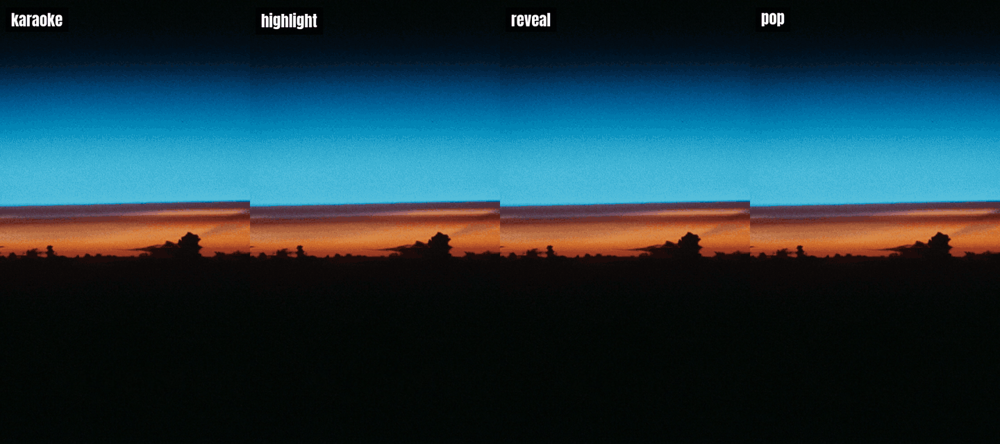

<div align="center">

# ffmpeg-word-captions

**Word-by-word captions, the kind short-form video uses, from any transcript with word timestamps, burned in by ffmpeg in one command. No editor, no subscription.**




[Why](#why) · [Styles](#styles) · [Install](#install) · [Usage](#usage) · [Transcripts](#transcripts) · [How it works](#how-it-works) · [Limits](#limits)

</div>

---

Give it the JSON from Whisper, faster-whisper, WhisperX, whisper.cpp, Deepgram, AssemblyAI or ElevenLabs Scribe. It writes an ASS subtitle file in one of four styles, sized in your video's own pixels, with lines broken the way a subtitler breaks them, and can burn it in with ffmpeg's `ass` filter (libass) in the same command.

Every panel above was burned in by this tool, with the commands under [Usage](#the-demo-above).

## Why

Word-timed captions keep people watching with the sound off, and most of the tools that make them are editors or paid apps. Speech-to-text models already give you word timestamps for free. What is missing is the step between: turning those timestamps into captions that look right, then into pixels. ASS, the subtitle format libass renders, can do per-word timing and styling, and ffmpeg ships libass in its standard builds. This tool writes that file well.

## Styles

| `--style` | What it does | ASS underneath |
| --- | --- | --- |
| `karaoke` (default) | the line is up; each word fills with the highlight colour as it is said, a smooth sweep | one event a line, `\kf` per word |
| `highlight` | the line is up; only the word being said is in the highlight colour, at 112 % | one event a word, `\1c` and `\fscx`/`\fscy` on that word |
| `reveal` | the line builds up word by word as they are said | one event a line, `\ko` per word, unsaid words fully transparent |
| `pop` | one word at a time, big, in the middle of the frame, scaling in | one event a word, `\t` from 70 % to 112 % to 100 % in 170 ms |

## Install

Node.js 18.17 or newer. To burn captions in, **ffmpeg** built with libass (the standard builds are). Writing the `.ass` file alone needs only Node. Windows, macOS or Linux; no npm dependencies.

```sh
# run it once, without installing
npx github:CosLynxAI/ffmpeg-word-captions transcript.json --video in.mp4 --burn out.mp4

# or install the command
npm install -g github:CosLynxAI/ffmpeg-word-captions

# or from source
git clone https://github.com/CosLynxAI/ffmpeg-word-captions && cd ffmpeg-word-captions
node bin/cli.js examples/whisper.json --frame 1080x1920
```

If ffmpeg is not on your PATH, set `FFMPEG_PATH` and `FFPROBE_PATH`.

## Usage

```
ffmpeg-word-captions <transcript.json> [-o captions.ass] [--style karaoke] [--video in.mp4 [--burn out.mp4]] [options]
```

| Option | Default | |
| --- | --- | --- |
| `-o`, `--out` | the transcript's name, `.ass` | where to write the ASS file |
| `--style` | `karaoke` | `karaoke`, `highlight`, `reveal`, `pop` |
| `--video` | | the video the captions are for: its size is read with ffprobe (rotation included), so type and margins are in its pixels |
| `--frame` | `1080x1920` | the size, `WxH`, when there is no `--video` |
| `--burn` | | write this video with the captions burned in (needs `--video`) |
| `--font` | `Arial` | the font family |
| `--fonts-dir` | | a folder of `.ttf`/`.otf` files for `--burn`, so libass finds `--font` without installing it |
| `--font-size` | 7 % of the short side (pop: 11 %) | in pixels |
| `--color` / `--highlight` / `--outline` | `#ffffff` / `#ffd400` / `#000000` | `#rrggbb`, or `#rrggbbaa` with opacity |
| `--box` | off | an opaque box behind the line instead of an outline |
| `--position` | `bottom` (pop: `middle`) | `bottom`, `middle`, `top` |
| `--uppercase` | off | |
| `--max-words` / `--max-chars` | 7 / 28 on a tall frame, 42 on a wide one | the most a line holds |

### Write the file

```
$ ffmpeg-word-captions examples/whisper.json -o captions.ass --frame 1080x1920 --style highlight
wrote captions.ass: 19 words, style highlight, 1080x1920
burn it in:  ffmpeg -i input.mp4 -vf "ass=captions.ass" -c:a copy output.mp4   (run in /path/to/your/folder)
```

The start of that file:

```
[Script Info]
; Written by ffmpeg-word-captions
ScriptType: v4.00+
PlayResX: 1080
PlayResY: 1920
WrapStyle: 2
ScaledBorderAndShadow: yes
YCbCr Matrix: None

[V4+ Styles]
Format: Name, Fontname, Fontsize, PrimaryColour, SecondaryColour, OutlineColour, BackColour, Bold, Italic, Underline, StrikeOut, ScaleX, ScaleY, Spacing, Angle, BorderStyle, Outline, Shadow, Alignment, MarginL, MarginR, MarginV, Encoding
Style: Word,Arial,76,&H00FFFFFF,&H00FFFFFF,&H00000000,&H80000000,-1,0,0,0,100,100,0,0,1,6,3,2,86,86,230,1

[Events]
Format: Layer, Start, End, Style, Name, MarginL, MarginR, MarginV, Effect, Text
Dialogue: 0,0:00:00.30,0:00:00.71,Word,,0,0,0,,{\1c&H0000D4FF\fscx112\fscy112}Every{\1c&H00FFFFFF\fscx100\fscy100} word lights up
Dialogue: 0,0:00:00.71,0:00:01.09,Word,,0,0,0,,Every {\1c&H0000D4FF\fscx112\fscy112}word{\1c&H00FFFFFF\fscx100\fscy100} lights up
Dialogue: 0,0:00:01.09,0:00:01.54,Word,,0,0,0,,Every word {\1c&H0000D4FF\fscx112\fscy112}lights{\1c&H00FFFFFF\fscx100\fscy100} up
```

### Write and burn in one go

```sh
ffmpeg-word-captions transcript.json --video in.mp4 --burn out.mp4
ffmpeg-word-captions transcript.json --style pop --font Anton --fonts-dir ./fonts --video in.mp4 --burn out.mp4
```

`--burn` re-encodes the video with ffmpeg's default encoder for the container and copies the audio unchanged. To choose the encoder and quality yourself, write the file and run ffmpeg:

```sh
ffmpeg -i in.mp4 -vf "ass=captions.ass:fontsdir=fonts" -c:v libx264 -crf 18 -c:a copy out.mp4
```

### The demo above

Each panel is a 540 × 960 clip, captioned from [examples/whisper.json](examples/whisper.json):

```sh
ffmpeg-word-captions whisper.json -o karaoke.ass --style karaoke --font Anton --fonts-dir fonts --font-size 60 --max-chars 18 --video bg.mp4 --burn karaoke.mp4
#   ...the same for highlight and reveal...
ffmpeg-word-captions whisper.json -o pop.ass --style pop --font Anton --fonts-dir fonts --video bg.mp4 --burn pop.mp4
```

The four results were then labelled and set side by side with ffmpeg. The background is a NASA photo of the Earth's limb at sunrise from STS-43 ([s43-22-011](https://images.nasa.gov/details/s43-22-011), public domain, found with our [open-media-finder](https://github.com/CosLynxAI/open-media-finder)). The font is [Anton](https://fonts.google.com/specimen/Anton) (SIL Open Font License), which is not included here.

### From code

```js
const { buildAss, wordsOf } = require("ffmpeg-word-captions");

const ass = buildAss(wordsOf(whisperJson), { style: "highlight", width: 1080, height: 1920, font: "Anton" });
```

`wordsOf(json)` gives `[{ w, start, end }]` in seconds from any transcript below. `buildAss(words, options)` takes the CLI options in camelCase (`size`, `maxWords`, `maxChars`, `uppercase`, ...) plus `outlineWidth` and `linger`, the seconds a line stays after its last word (0.4).

## Transcripts

| Tool | How to get word timestamps | What is read |
| --- | --- | --- |
| [OpenAI Whisper](https://github.com/openai/whisper), faster-whisper | `whisper audio.mp3 --word_timestamps True --output_format json` | `segments[].words[]` |
| [WhisperX](https://github.com/m-bain/whisperX) | `whisperx audio.mp3 --output_format json` | `segments[].words[]` or `word_segments[]` |
| [whisper.cpp](https://github.com/ggerganov/whisper.cpp) | `whisper-cli -m model.bin -f audio.wav -ojf` | `transcription[].tokens[]`, tokens joined into words |
| Deepgram | the response JSON, as saved | `results.channels[0].alternatives[0].words[]`, `punctuated_word` first |
| AssemblyAI | the transcript JSON, as saved | `words[]`, in milliseconds |
| ElevenLabs Scribe | the response JSON, as saved | `words[]` of type `word` |
| anything else | `[{ "word": "Hello", "start": 0.5, "end": 0.9 }, ...]` in seconds, alone or as `{ "words": [...] }` | `word`, `text` or `w` |

The format is recognised from the JSON's shape; there is no flag to set.

## How it works

**Words.** Each format is read into `[{ w, start, end }]` and sorted by start. Some tools give a word that ends before it starts, or overlaps the next, so each word is made to end by the next word's start (and last at least 10 ms). AssemblyAI's milliseconds are told from Scribe's seconds by the transcript's `status` or `audio_duration` fields, or failing those, by untyped whole-number times past 1000.

**Lines.** Words are grouped the way a subtitler would group them:

- a line ends at a sentence end (`. ! ? ; :`), at a pause over 0.45 s, or at a comma once it holds three words;
- otherwise at `--max-words` or `--max-chars`, and a line broken for length never ends on a little word ("the", "and", "of", "to", ...): up to two of them move to the next line;
- a length break that would leave one or two words alone on the next line splits the pair of lines evenly instead, again never ending a line on a little word.

`pop` skips this: one word, one event.

**Timing.** In `karaoke` and `reveal`, each word's `\k` duration runs from its start to the next word's start, in centiseconds, so the sweep never waits or jumps between words. A line stays up 0.4 s after its last word unless the next line starts sooner.

**Look.** `PlayResX`/`PlayResY` are the video's size, so every size is in its pixels: font 7 % of the short side (11 % for pop), outline 8 % of the font size, side margins 8 % of the width, bottom margin 12 % of the height. Colours become ASS `&HAABBGGRR`.

**Safety.** Braces and backslashes are removed from word text, so a transcript cannot inject ASS override tags. On `--burn`, ffmpeg runs in the `.ass` file's folder and gets relative paths, so a Windows drive letter never needs escaping inside the filter string.

## Limits

- **Lines are broken by count, not measured width.** The file sets `WrapStyle: 2`, so libass never re-wraps a line. With a wide font or a large `--font-size`, lower `--max-chars` (the demo uses 18 at 60 px on a 540 px frame).
- **One speaker style.** Speaker labels in a transcript are not used, and every line uses one style.
- **`--burn` re-encodes with ffmpeg's defaults.** For a chosen codec or quality, burn the file yourself (above).
- **Timing is the transcript's.** Words a speech-to-text model mistimes are captioned mistimed.
- **Fonts:** libass falls back to another font when `--font` is not installed or not in `--fonts-dir`, without an error.

## Development

```sh
npm test          # unit tests, plus a real burn of every style when ffmpeg is installed
```

## Contributing

Issues and pull requests are welcome, especially a transcript format that is not read yet: attach a short sample of its JSON. Each format has a case in `test/captions.test.js`.

## Licence

MIT, see [LICENSE](LICENSE).

## Made by Coslynx

[Coslynx](https://coslynx.com) makes Content Factory, software that makes short-form video for brands and channels on your own computer, with your own Claude plan. We built this tool while making it, and keep it open.
